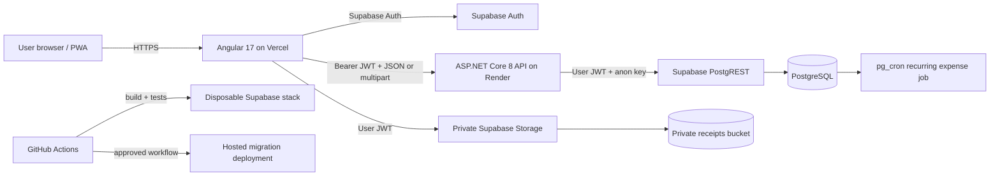
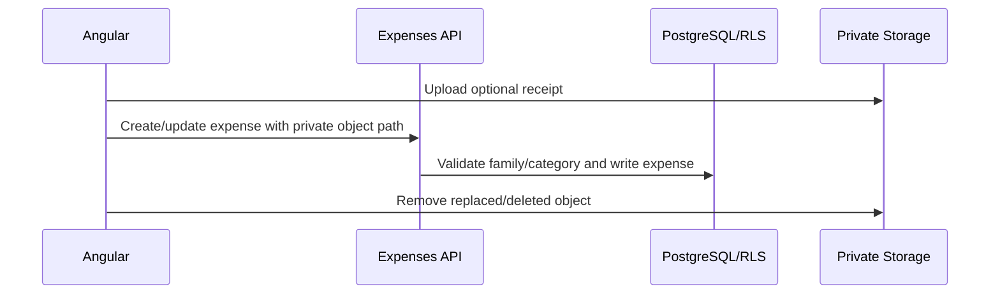
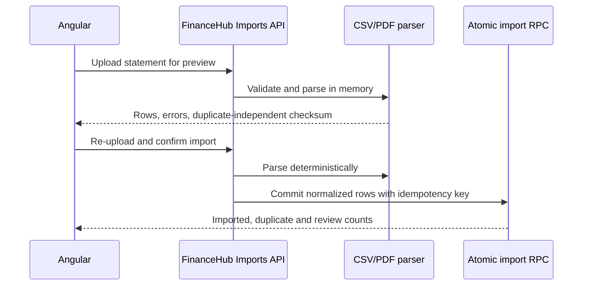

# Current architecture and FinanceHub gap map

## Runtime architecture

## Existing application boundaries

- **Angular PWA:** authentication, onboarding, dashboard, expenses, budgets, finance tools, family management, notifications and the data-source catalogue.
- **ASP.NET Core API:** validates Supabase JWTs, applies application validation, and calls PostgREST with the same user token so database RLS remains the final authorization boundary.
- **Supabase Auth:** email confirmation, password recovery and JWT issuance.
- **PostgreSQL:** family ledger, categories, expenses, budgets, savings, EMIs, notifications, recurring-expense jobs and FinanceHub aggregation tables.
- **Supabase Storage:** private, user-prefixed receipt objects exposed only through short-lived signed URLs.
- **Delivery:** Angular preview/production deployments through Vercel, API container on Render, and guarded Supabase migration deployment through GitHub Actions.

## Current FinanceHub foundation

The database already contains:

- `financial_accounts`
- `provider_connections`
- `import_runs`
- `raw_transactions`
- `financehub_transactions`
- `transaction_matches`
- `categorization_rules`

The source catalogue exposes bank, card, UPI and cash capability descriptions. Cash uses the existing expense flow. Bank, card and UPI connection attempts correctly return HTTP 501 because no regulated provider is configured.

## Current transaction paths

### Manual expense

### Planned statement import

## Gap decision

| Capability | Current state | Decision for this phase |
|---|---|---|
| Automatic bank sync | Blocked by FIU/AA onboarding | Keep disabled; add a provider adapter contract only |
| Automatic card sync | Blocked by provider/issuer coverage | Keep disabled; support card statements |
| Direct UPI history | No generic consumer API | Detect UPI from bank/card narration and references |
| CSV import | Schema only | Implement preview and atomic commit |
| PDF import | Not implemented | Implement text-PDF extraction with review-required parsing |
| Raw ingestion integrity | Client policies are too broad | Make raw/canonical ingestion service-owned through a guarded RPC |
| Deduplication | Schema supports fingerprints | Enforce deterministic fingerprints and import idempotency |
| User review | No import preview | Add a preview table with validation errors |
| Background sync | No provider | Defer until provider onboarding |
| Provider credentials/webhooks | No provider | Define adapter boundary; do not add fake credentials or webhooks |

## Delivery slice

This phase implements user-initiated CSV and text-based PDF statement imports, preview, validation, UPI rail detection, deterministic deduplication, immutable raw records, canonical transaction writes and RLS tests. Scanned/image PDFs remain unsupported until an isolated OCR pipeline is selected. Automatic sync remains unavailable until a regulated provider relationship exists.
